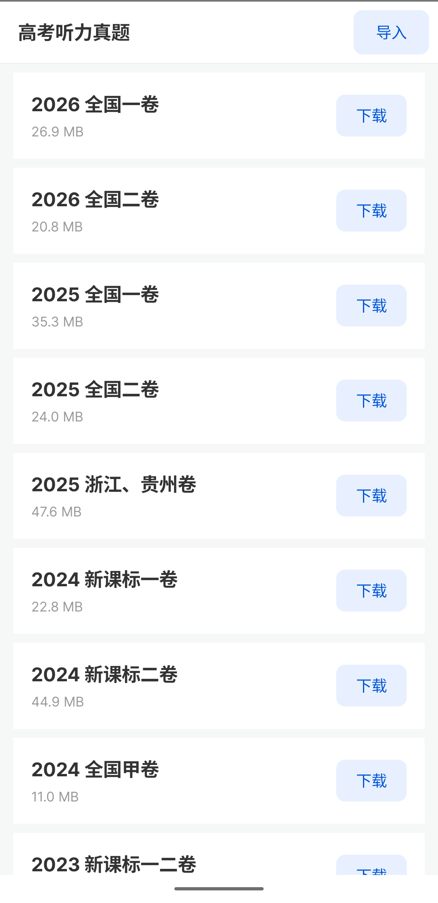
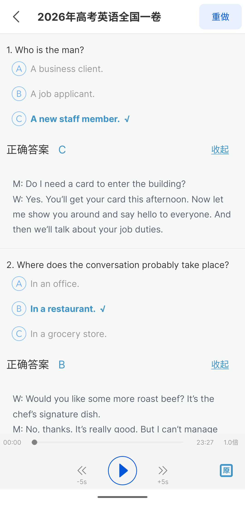
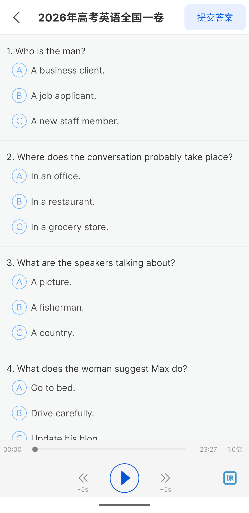

<div align="center">
  
  <h1>GK-TL · 高考听力真题</h1>
  <p>2011–2026 高考英语听力真题，29 套，在线下载，离线练习。</p>
  <p>
    
    
    
  </p>
</div>

## 简介

GK-TL 是一个面向高考英语听力备考的 Android 本地播放器。内置 2011–2026 年共 29 套真题目录，
可按需在线下载，下载后完全离线使用。也可以导入自己制作的 `.tklib` 题库包。

界面设计：整卷播放、A/B/C 单选、交卷判分、题目下方展开原文。

## 功能

- **29 套真题**：2011–2026 全国卷、全国一/二/三卷、新课标卷、新高考卷、浙江/贵州卷等。
- **在线下载**：按套下载，显示进度；已下载可离线打开，也可删除后重下。
- **本地导入**：支持导入 `.tklib` 题库包，适合自己整理的材料。
- **整卷播放**：播放/暂停、拖动进度、-5s / +5s、0.75x / 1.0x / 1.25x / 1.5x 倍速。
- **答题判分**：20 题 A/B/C 单选，交卷后逐题显示正确答案与对错。
- **原文对照**：每题的“原文”在题目下方原地展开，不需要跳转页面。

## 截图

| 题库列表 | 交卷后 | 答题中 |
|---|---|---|
|  |  |  |
| 29 套真题，按需下载 | 正确答案与题下原文 | 整卷播放与提交答案 |

## 技术栈

- Java 17，Android SDK 26+（Android 8.0 及以上）
- 原生 Android View 体系，不依赖第三方 UI 库
- `MediaPlayer` 整卷播放，`PlaybackParams` 倍速
- 手动构建链：`aapt2` + `javac` + `d8` + `zipalign` + `apksigner`，不依赖 Gradle

## 项目结构

```
app/
├─ AndroidManifest.xml
├─ src/com/gkyytlzt/lynn/        Java 源码
└─ res/                          布局、图标、颜色、尺寸

tools/
├─ parse_docx.py                 docx → JSON 题目解析
├─ verify_set.py                 JSON 与 docx 逐行交叉校验
├─ build_tklib.py                JSON + mp3 → .tklib 题库包
└─ build.sh                      App 构建脚本（Windows + Git Bash）
```

## 构建

环境要求：

- Windows 10/11 + Git Bash
- JDK 17（设置 `JAVA_HOME`）
- Android SDK，build-tools 36、platform android-36
- Python 3（用于打包步骤和题库工具）

```bash
export JAVA_HOME="/c/Program Files/Java/jdk-17"
export ANDROID_HOME="$LOCALAPPDATA/Android/Sdk"
bash tools/build.sh
```

产物：`out/GK-TL.apk`。脚本会在 `keystore/` 下生成一个本地测试签名，仅用于自己安装，
不要用于正式发布。

## 题库包格式

`.tklib` 是一个 zip，只有两个文件：

```
manifest.json
audio.mp3
```

`manifest.json` 的关键字段：

```json
{
  "schema": 1,
  "id": "2026_qg1",
  "title": "2026年高考英语全国一卷",
  "year": 2026,
  "series": "全国一卷",
  "audio": "audio.mp3",
  "audioSha256": "…",
  "questions": [
    {
      "no": 1,
      "stem": "…",
      "options": {"A": "…", "B": "…", "C": "…"},
      "answer": "C",
      "textNo": 1
    }
  ],
  "texts": [
    {"no": 1, "content": "W: …\nM: …"}
  ]
}
```

制作自己的题库包：

```bash
python tools/parse_docx.py <docx> <mp3> <out.json> <id> "<title>" <year> "<series>"
python tools/verify_set.py <docx> <out.json>
python tools/build_tklib.py <json> <mp3> <out.tklib>
```

## 免责声明

本项目仅用于个人英语听力学习。真题、录音及文字内容的版权归原命题、出版或整理方所有；
本项目不主张任何内容版权，不提供官方答案，也不对考试结果作任何保证。
请勿将本项目用于商业用途或重新分发受版权保护的内容。

## License

[MIT](LICENSE)

开发者：lynnled
